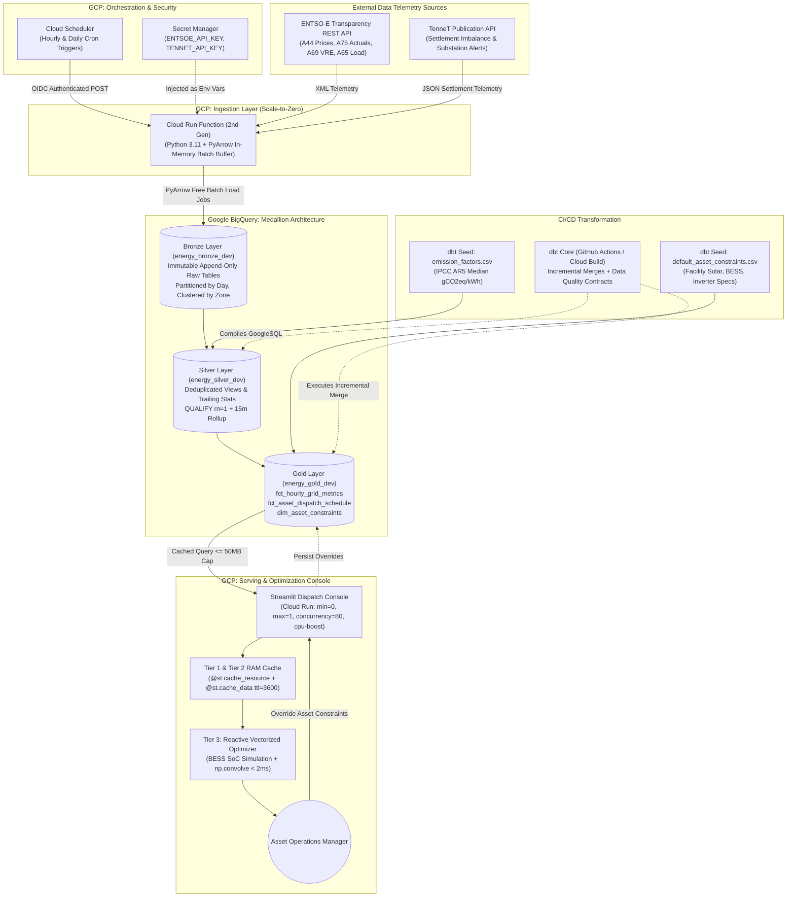

# OptiGrid: Autonomous Commercial Asset Energy Arbitrage & Carbon Dispatch Platform

> **A Production Zero-Cost Serverless Data Pipeline & Real-Time Battery Storage Optimization Engine on Google Cloud Platform**

[](https://github.com/your-username/energy-carbon-pipeline/actions/workflows/ci.yml)
[](https://github.com/your-username/energy-carbon-pipeline/actions/workflows/dbt_hourly_run.yml)
[](LICENSE)
[](https://github.com/astral-sh/ruff)

---

## Table of Contents

1. [Executive Summary & Commercial Motivation](#1-executive-summary--commercial-motivation)
2. [End-to-End System Architecture](#2-end-to-end-system-architecture)
3. [Zero-Cost Serverless FinOps & Quota Mathematics](#3-zero-cost-serverless-finops--quota-mathematics)
4. [External API Integrations & Telemetry Engineering](#4-external-api-integrations--telemetry-engineering)
5. [The Medallion Warehouse Architecture (BigQuery + dbt)](#5-the-medallion-warehouse-architecture-bigquery--dbt)
6. [Mathematical Formulations & Derivations](#6-mathematical-formulations--derivations)
7. [Repository Structure & File-by-File Blueprint](#7-repository-structure--file-by-file-blueprint)
8. [Infrastructure-as-Code (Terraform Provisioning)](#8-infrastructure-as-code-terraform-provisioning)
9. [Data Transformation & Testing Layer (dbt Core)](#9-data-transformation--testing-layer-dbt-core)
10. [Serving & Visualization Layer (Streamlit on Cloud Run)](#10-serving--visualization-layer-streamlit-on-cloud-run)
11. [CI/CD, Code Quality & Local Testing](#11-cicd-code-quality--local-testing)
12. [Local Quickstart & Execution Guide](#12-local-quickstart--execution-guide)

---

## 1. Executive Summary & Commercial Motivation

Wholesale electricity in Europe clears on a **marginal pricing auction** (the *Merit Order Effect*). Generators bid capacity ordered by short-run marginal costs: variable renewables (solar and wind at $\approx 0\text{ EUR/MWh}$) clear first, followed by nuclear, hydro, coal, and natural gas peaking plants (up to $160+\text{ EUR/MWh}$). The last generator needed to meet demand sets the clearing price ($P_t$) for all participants.

Because financial markets and physical grid telemetry operate independently, **energy price and carbon intensity frequently decouple**:

* **The Nighttime Baseload Trap (02:00–05:00):** Demand drops, shutting off peaker gas plants and driving prices down. However, with zero solar generation, the residual load is often met by coal or lignite, causing **Carbon Intensity ($CI_t$) to spike** even when electricity is cheap.
* **The Midday Solar Duck Curve (12:00–15:00):** Massive solar and wind generation pushes fossil plants out of the merit order, creating **negative prices ($P_t < 0$)** and minimal carbon intensity simultaneously.
* **Substation Congestion Bottlenecks:** Local transmission grid operators (such as TenneT in the Netherlands or PSE in Poland) frequently issue physical grid export restrictions. Commercial solar arrays without automated storage or curtailment controls risk heavy financial penalties or substation overload.

**OptiGrid** bridges wholesale electricity markets, physical power grid telemetry, and transmission operator grid constraints. It provides automated day-ahead battery energy storage system (BESS) scheduling, industrial load ramping, and solar export curtailment safeguards across three major European bidding zones:
* 🇳🇱 **Netherlands (`10YNL----------L`)**
* 🇩🇪🇱🇺 **Germany-Luxembourg (`10Y1001A1001A82H`)**
* 🇵🇱 **Poland (`10YPL-AREA-----S`)**

---

## 2. End-to-End System Architecture

The pipeline eliminates idle cloud infrastructure by utilizing an **event-driven, scale-to-zero serverless architecture** across Google Cloud Platform (GCP).



---

## 3. Zero-Cost Serverless FinOps & Quota Mathematics

Traditional enterprise data engineering architectures provision managed clusters (e.g., Cloud Composer / Apache Airflow) that bill continuously 24/7, costing **~$300–$500/month** even when idling 99.9% of the day.

OptiGrid scales entirely to zero between executions. Ingestion containers spin up for ~3.5 seconds per run, stream data via shared batch pools, and terminate immediately.

### Resource-by-Resource Monthly Quota Breakdown (31 Days)

| Service | Pipeline Monthly Consumption Calculation | Monthly Usage | GCP Always-Free Tier Limit | % of Quota Used |
| :--- | :--- | :--- | :--- | :--- |
| **Cloud Run Compute (vCPU)** | Ingestion: $744\text{ runs} \times 3.5\text{s} \times 1\text{ vCPU} = 2,604\text{s}$<br/>Dashboard: $100\text{ visits} \times 5\text{s} \times 1\text{ vCPU} = 500\text{s}$ | **$3,104\text{ vCPU-s}$** | $180,000\text{ vCPU-s / mo}$ | **$1.72\%$** |
| **Cloud Run Memory (RAM)** | Ingestion: $2,604\text{s} \times 0.5\text{ GiB} = 1,302\text{ GiB-s}$<br/>Dashboard: $500\text{s} \times 0.5\text{ GiB} = 250\text{ GiB-s}$ | **$1,552\text{ GiB-s}$** | $360,000\text{ GiB-s / mo}$ | **$0.43\%$** |
| **Cloud Run Invocations** | $744\text{ cron runs} + 2,000\text{ UI requests}$ | **$\sim 2,750\text{ reqs}$** | $2,000,000\text{ reqs / mo}$ | **$0.14\%$** |
| **BigQuery Storage** | $\sim 5,000\text{ rows/month} \times 120\text{ bytes} \approx 0.6\text{ MB/mo}$ | **$< 0.01\text{ GiB}$** | $10.0\text{ GiB active / mo}$ | **$< 0.1\%$** |
| **BigQuery Query Compute** | dbt Builds ($744 \times 2\text{ MB}$) + Dashboard ($744 \times 1\text{ MB}$) | **$\sim 2.22\text{ GiB}$** | $1,024\text{ GiB (1 TiB) / mo}$ | **$0.22\%$** |
| **Artifact Registry** | Container images with Terraform `keep_count = 1` | **$0.28\text{ GiB}$** | $0.50\text{ GiB / mo}$ | **$56.0\%$** |
| **Secret Manager** | 2 active secrets (`ENTSOE_API_KEY`, `TENNET_API_KEY`) | **$2\text{ versions}$** | $6\text{ versions / mo}$ | **$33.3\%$** |
| **Cloud Scheduler** | 3 cron triggers (Hourly Actuals, Daily Forecasts, TenneT) | **$3\text{ jobs}$** | $3\text{ jobs / mo}$ | **$100.0\%$** |
| **Monthly Bill** | | | | **$0.00 / month** |

### The Streaming API vs. PyArrow Batch Load Trap
`bigquery_client.insert_rows_json()` uses BigQuery's legacy Streaming API, which bypasses free query quotas, bills $0.01 per 200 MB ingested, and locks partitions against DML merges for up to 90 minutes. OptiGrid utilizes `client.load_table_from_dataframe()` with PyArrow Parquet serialization, executing on Google's shared batch slot pool at **$0.00 compute cost**.

---

## 4. External API Integrations & Telemetry Engineering

### A. ENTSO-E Transparency Platform REST API
* **Base URL:** `https://web-api.tp.entsoe.eu/api`
* **Authentication:** Query parameter security token (`?securityToken=...`)
* **Area Identifiers (EIC Codes):**
  * Netherlands: `10YNL----------L`
  * Germany-Luxembourg: `10Y1001A1001A82H`
  * Poland: `10YPL-AREA-----S`

#### Core Endpoints & Document Types

| Dataset | documentType | processType | Parameter Name | Resolution | Telemetry Role |
| :--- | :--- | :--- | :--- | :--- | :--- |
| **Day-Ahead Prices** | `A44` | *None* | `in_Domain` = `out_Domain` | `PT60M` / `PT15M` | Published daily at 12:45 CET for all 24 hours of $D+1$ in $\text{EUR/MWh}$. |
| **Actual Generation** | `A75` | `A16` (Realised) | `in_Domain` | `PT15M` / `PT60M` | Near real-time generation by fuel type up to $t_{\text{now}}$ in $\text{MW}$. |
| **Wind & Solar Forecast**| `A69` | `A01` (Day Ahead) | `in_Domain` | `PT15M` / `PT60M` | Day-ahead solar, onshore wind, and offshore wind power forecast in $\text{MW}$. |
| **Total Load Forecast** | `A65` | `A01` (Day Ahead) | `outBiddingZone_Domain` | `PT15M` / `PT60M` | Expected total electrical grid demand across $D+1$ in $\text{MW}$. |

#### PSR (Power System Resource) Mapping & IPCC Emission Factors
The Silver transformation joins generation actuals against `emission_factors.csv`, mapping each ENTSO-E `psr_type` to its IPCC 5th Assessment Report (AR5) median life-cycle emission factor:

| PSR Code | Generation Source | IPCC Life-Cycle $EF_i$ ($\text{gCO}_2\text{eq/kWh}$) | Renewable Flag | Dispatch Category |
| :--- | :--- | :---: | :---: | :--- |
| `B01` | Biomass | 230.0 | `TRUE` | Dispatchable Renewable |
| `B02` | Fossil Brown Coal / Lignite | 1000.0 | `FALSE` | Thermal Baseload / Peaker |
| `B03` | Fossil Coal-Derived Gas | 700.0 | `FALSE` | Thermal Peaker |
| `B04` | Fossil Gas (CCGT / OCGT) | 490.0 | `FALSE` | Thermal Marginal |
| `B05` | Fossil Hard Coal | 820.0 | `FALSE` | Thermal Marginal |
| `B06` | Fossil Oil | 650.0 | `FALSE` | Thermal Peaker |
| `B09` | Geothermal | 38.0 | `TRUE` | Renewable Baseload |
| `B10` | Hydro Pumped Storage | 24.0 | `FALSE` | Storage / Peaking |
| `B11` | Hydro Run-of-River | 24.0 | `TRUE` | Renewable Baseload |
| `B12` | Hydro Water Reservoir | 24.0 | `TRUE` | Dispatchable Renewable |
| `B14` | Nuclear | 12.0 | `FALSE` | Low-Carbon Baseload |
| `B15` | Other Renewable | 50.0 | `TRUE` | Variable Renewable |
| `B16` | Solar Photovoltaic | 45.0 | `TRUE` | Variable Renewable (VRE) |
| `B17` | Waste | 350.0 | `FALSE` | Thermal Baseload |
| `B18` | Wind Offshore | 12.0 | `TRUE` | Variable Renewable (VRE) |
| `B19` | Wind Onshore | 11.0 | `TRUE` | Variable Renewable (VRE) |
| `B20` | Other (Unspecified Thermal) | 500.0 | `FALSE` | Thermal Marginal |
| `B25` | Energy Storage | 0.0 | `FALSE` | Grid Battery System |

### B. TenneT Publication REST API (Dutch Transmission Grid)
* **Base URL:** `https://api.tennet.eu/publications/v1`
* **Authentication:** Custom HTTP header (`apikey: ...`)
* **Settlement Prices (`/settlement-prices`):** Returns 15-minute imbalance settlement telemetry ($ISP$) including shortage price, surplus price, regulation state (-1, 0, +1), and upward/downward dispatch volumes. Accounts for the TSO settlement delay window by querying a sliding 24-to-48 hour lookback.
* **Congestion Alerts:** Telemetry covering Dutch grid substations (e.g., `NL-RANDSTAD-NORTH`, `NL-RANDSTAD-SOUTH`). When active congestion restrictions occur, export capacity limits are de-rated (e.g., export limit factor de-rated to 0.35) to prevent substation feeder overload.

---

## 5. The Medallion Warehouse Architecture (BigQuery + dbt)

```text
energy-carbon/
├── Bronze Layer (Raw Ingestion Landing)
│   ├── raw_generation_actuals      [Partition: DATE(timestamp_utc) | Cluster: bidding_zone, psr_type]
│   ├── raw_day_ahead_prices        [Partition: DATE(timestamp_utc) | Cluster: bidding_zone]
│   ├── raw_grid_forecasts          [Partition: DATE(timestamp_utc) | Cluster: bidding_zone, metric_type]
│   ├── raw_tennet_imbalance        [Partition: DATE(timestamp_utc) | Cluster: bidding_zone]
│   └── raw_tennet_congestion       [Partition: DATE(timestamp_utc) | Cluster: bidding_zone]
│
├── Silver Layer (Deduplication, Grain Alignment & Trailing Stats)
│   ├── stg_generation_actuals      (View: Native 15m dedup -> Hourly downsampling via AVG)
│   ├── stg_day_ahead_prices        (View: Hourly price grain alignment)
│   ├── stg_grid_forecasts          (View: Hourly solar, wind, load pivot)
│   ├── stg_tennet_imbalance        (View: Hourly average shortage/surplus settlement prices)
│   ├── stg_tennet_congestion       (View: Hourly substation congestion severity & export factors)
│   ├── int_grid_trailing_baselines (Table: Trailing 72h baseload stats + 168h thermal fleet factor)
│   └── int_forecast_carbon_hourly  (Incremental: Future residual thermal carbon model)
│
└── Gold Layer (Serving Marts & Asset Simulation)
    ├── dim_asset_constraints       (Incremental: Commercial facility physical parameters)
    ├── fct_hourly_grid_metrics     (Incremental: Spliced price, carbon, renewable share, & rolling bounds)
    └── fct_asset_dispatch_schedule (Incremental: Stateful BESS SoC, curtailment, & cost savings)
```

### Key Engineering Traps Solved in the Warehouse

#### Trap 1: Variable-Sized Block Compression (`curveType = A03`)
Under ENTSO-E curve type `A03`, if consecutive intervals have identical values, ENTSO-E omits repeated timestamps from XML payloads. Ingestion enforces dense, gap-free grids using `resample("1h").ffill()` for prices and `resample("1h").mean()` for generation before warehouse loading.

#### Trap 2: Average of Ratios vs. Ratio of Sums
When downsampling four 15-minute generation blocks ($q \in \{1,2,3,4\}$) to hourly energy, calculating carbon intensity per quarter-hour and taking the arithmetic mean is mathematically invalid because total load varies across intervals.
* **Physically Exact Approach:** Compute hourly energy per fuel first ($\overline{G}_{i,h} = \frac{1}{4}\sum_{q=1}^4 G_{i,h,q}$), then divide total weighted emissions by total generation:
  $$CI_h = \frac{\sum_i \left( \overline{G}_{i,h} \times EF_i \right)}{\sum_i \overline{G}_{i,h}}$$

#### Trap 3: The Temporal Boundary Asymmetry ($t_{\text{now}}$)
At 12:45 CET, day-ahead prices (`A44`) are known for up to 35 hours into the future, but physical generation (`A75`) is strictly $0$ for future intervals.
* A naive SQL `INNER JOIN` drops tomorrow's entire price timeline.
* OptiGrid drives the join from prices (`p`), left-joins measured carbon ($a$), left-joins forecasted carbon ($fc$), and splices them seamlessly via `COALESCE(a.actual_ci_gco2_kwh, fc.forecast_ci_gco2_kwh)`.

---

## 6. Mathematical Formulations & Derivations

### Step 1: Real-Time Grid Carbon Intensity ($CI_t$)
Active power $G_{i,t}$ in Megawatts converts to energy generated over interval $\Delta t$ (hours). With conversion factor $10^3\text{ kWh/MWh}$, the scalar cancels from numerator and denominator:

$$CI_t = \frac{\sum_{i \in \text{Fuels}} \left( G_{i,t} \times EF_i \right)}{\sum_{i \in \text{Fuels}} G_{i,t}} \quad \left[\frac{\text{gCO}_2\text{eq}}{\text{kWh}}\right]$$

### Step 2: Self-Calibrating Day-Ahead Carbon Intensity Forecast ($\widehat{CI}_t$)
For future hours ($t > t_{\text{now}}$), residual thermal demand is estimated dynamically:

$$\hat{R}_t = \max\left(0, \; \hat{L}_t - \hat{G}_{\text{VRE}, t} - \hat{G}_{\text{base}}\right)$$

Where:
* $\hat{L}_t$ is forecasted total load (`A65`).
* $\hat{G}_{\text{VRE}, t} = \hat{G}_{\text{solar}, t} + \hat{G}_{\text{wind\_on}, t} + \hat{G}_{\text{wind\_off}, t}$ (`A69`).
* $\hat{G}_{\text{base}}$ and $EF_{\text{base}}$ are calibrated dynamically from the trailing 72 hours of low-carbon baseload (`B09`, `B11`, `B14`).
* $\overline{EF}_{\text{thermal}}$ is the empirical emission factor of dispatchable thermal plants over the trailing 168 hours (7 days):

$$\overline{EF}_{\text{thermal}} = \frac{\sum_{\tau \in [t_{\text{now}}-168\text{h}, \, t_{\text{now}}]} \sum_{i \in \text{Thermal}} G_{i,\tau} EF_i}{\sum_{\tau \in [t_{\text{now}}-168\text{h}, \, t_{\text{now}}]} \sum_{i \in \text{Thermal}} G_{i,\tau}}$$

The physical residual-load forecast equation is:

$$\widehat{CI}_t = \frac{\hat{G}_{\text{solar}, t} EF_{\text{solar}} + \hat{G}_{\text{wind\_on}, t} EF_{\text{wind\_on}} + \hat{G}_{\text{wind\_off}, t} EF_{\text{wind\_off}} + \hat{G}_{\text{base}} EF_{\text{base}} + \hat{R}_t \overline{EF}_{\text{thermal}}}{\max\left(\hat{L}_t, \; \hat{G}_{\text{VRE}, t} + \hat{G}_{\text{base}}\right)}$$

### Step 3: Rolling Min-Max Normalization & Multi-Objective Optimization
To combine wholesale price (EUR/kWh, numerical span ~0.20) and carbon intensity (gCO₂/kWh, numerical span ~400) without scale bias, both metrics are scaled across the rolling 24-hour horizon ($H$):

$$\tilde{P}_t = \frac{P_t - \min_{\tau \in H} P_\tau}{\max_{\tau \in H} P_\tau - \min_{\tau \in H} P_\tau + \epsilon}, \qquad \widetilde{CI}_t = \frac{CI_t - \min_{\tau \in H} CI_\tau}{\max_{\tau \in H} CI_\tau - \min_{\tau \in H} CI_\tau + \epsilon}$$

With zero-division guard $\epsilon = 10^{-8}$. The composite optimization score is:

$$\text{Score}_t(\alpha) = \alpha \tilde{P}_t + (1 - \alpha) \widetilde{CI}_t \quad \in [0, 1]$$

* $\alpha = 1.0$: Pure financial arbitrage (100% cheapest).
* $\alpha = 0.0$: Pure ecological dispatch (100% greenest).
* $\alpha = 0.5$: Balanced Pareto optimum.

### Step 4: Discrete Sliding Window Convolution ($K$-Hour Cycle)
For continuous flexible industrial loads or appliances running across $K$ consecutive hours:

$$t^* = \underset{t}{\arg\min} \left( \frac{1}{K} \sum_{k=0}^{K-1} \text{Score}_{t+k}(\alpha) \right)$$

Evaluated in container RAM via 1D array convolution (`np.convolve(scores, np.ones(K)/K, mode='valid')`) in $< 2\text{ ms}$.

### Step 5: Commercial Asset Dispatch & BESS State Transitions
For facilities with rooftop solar ($S_t$), flexible loads ($L^{\text{flex}}_t$), and battery storage ($B_t$):
1. **Unmanaged Net Facility Load:**
   $$P^{\text{net}}_t = L^{\text{base}}_t + L^{\text{flex}}_t - S_t$$
2. **Surplus Absorption Safeguard:** If $P^{\text{net}}_t < -P^{\text{export\_limit}}$ or congestion is flagged, surplus power charges the BESS:
   $$P^{\text{bess}}_t = \min\left( |P^{\text{net}}_t|, \; P^{\text{max\_charge}}, \; \frac{B^{\text{max}} - B_t}{\sqrt{\eta}} \right)$$
3. **Curtailment Trigger:** If remaining export exceeds effective limit:
   $$P^{\text{curtail}}_t = \max\left(0, \; |P^{\text{net}}_t| - P^{\text{bess}}_t - P^{\text{export\_limit}}\right)$$
4. **State-of-Charge Update:**
   $$B_{t+1} = \begin{cases} B_t + P^{\text{bess}}_t \sqrt{\eta} & \text{if charging } (P^{\text{bess}} > 0) \\ B_t - \frac{|P^{\text{bess}}_t|}{\sqrt{\eta}} & \text{if discharging } (P^{\text{bess}} < 0) \end{cases}$$
   Clamped strictly within $[B^{\text{min}}, B^{\text{max}}]$.

---

## 7. Repository Structure & File-by-File Blueprint

```text
energy-carbon/
├── .github/
│   └── workflows/
│       ├── ci.yml                 # Runs Ruff (lint + format), Pytest, and SQLFluff on PR
│       ├── dbt_hourly_run.yml     # Hourly cron executing dbt incremental transformations
│       ├── deploy_cloud_run.yml   # Builds Docker image and deploys Streamlit to Cloud Run
│       ├── terraform_plan.yml     # Validates Terraform HCL infrastructure diff on PR
│       └── terraform_apply.yml    # Applies Terraform changes on merge to main
├── terraform/
│   ├── main.tf                    # GCP Infrastructure: BigQuery, Cloud Run, Cloud Functions, IAM
│   ├── variables.tf               # Input variables (project_id, region, alert_email)
│   ├── outputs.tf                 # Output endpoints (Function URI, Cloud Run Dashboard URL)
│   └── terraform.tfvars.example   # Example configuration variables
├── ingestion/
│   ├── main.py                    # Cloud Function HTTP entry point supporting multi-zone ingestion
│   ├── entsoe_client.py           # ENTSO-E client with PSR reverse normalization & block expansion
│   ├── tennet_client.py           # TenneT settlement prices client with lag recovery
│   ├── bq_loader.py               # Free PyArrow in-memory batch loader to BigQuery
│   └── requirements.txt           # Ingestion dependencies (entsoe-py, pyarrow, google-cloud-bigquery)
├── dbt_energy/
│   ├── dbt_project.yml            # dbt configuration with incremental BigQuery merge strategies
│   ├── profiles.yml               # BigQuery adapter connection profile
│   ├── seeds/
│   │   ├── emission_factors.csv          # IPCC AR5 emission factors lookup table
│   │   └── default_asset_constraints.csv # Commercial facility baseline profiles (NL, DE, PL)
│   └── models/
│       ├── bronze/sources.yml     # BigQuery source table definitions
│       ├── silver/
│       │   ├── stg_generation_actuals.sql  # Deduplication & hourly fuel energy rollup
│       │   ├── stg_day_ahead_prices.sql    # Deduplication & hourly wholesale prices
│       │   ├── stg_grid_forecasts.sql      # Solar, wind, & total load forecasts
│       │   ├── stg_tennet_imbalance.sql    # TenneT settlement imbalance telemetry
│       │   ├── stg_tennet_congestion.sql   # Substation congestion limits & redispatch
│       │   └── schema.yml                  # Silver data quality test contracts
│       ├── intermediate/
│       │   ├── int_grid_trailing_baselines.sql # 72h baseload & 168h thermal fleet calibrator
│       │   └── int_forecast_carbon_hourly.sql  # Physical day-ahead residual carbon model
│       └── gold/
│           ├── dim_asset_constraints.sql       # Live facility constraints with UI overrides
│           ├── fct_hourly_grid_metrics.sql     # Spliced price, carbon, & rolling bounds
│           ├── fct_asset_dispatch_schedule.sql # Stateful hourly BESS simulation ledger
│           └── schema.yml                      # Gold contracts (not_null, unique, accepted_values)
├── dashboard/
│   ├── app.py                     # Streamlit frontend with 3 visual tiers & interactive ledger
│   ├── asset_config.py            # Facility profile sidebar & BigQuery constraint sync
│   ├── data_fetcher.py            # Three-tier caching layer (@st.cache_resource, @st.cache_data)
│   ├── optimizer.py               # Vectorized BESS SoC simulation & window convolution engine
│   ├── Dockerfile                 # Slim Python 3.11 container with startup CPU boost
│   └── requirements.txt           # Dashboard dependencies (streamlit, plotly, db-dtypes)
├── tests/
│   ├── conftest.py                # Pytest fixtures and mock BigQuery schemas
│   ├── ingestion/
│   │   ├── test_entsoe_client.py  # Unit tests for XML parsing & PSR code normalization
│   │   ├── test_tennet_client.py  # Unit tests for settlement extraction & HTTP errors
│   │   └── test_bq_loader.py      # Unit tests for batch load schema enforcement
│   └── dashboard/
│       ├── test_optimizer.py      # Unit tests for BESS SoC transitions & window convolution
│       ├── test_asset_config.py   # Unit tests for default constraint dataframes
│       └── test_data_fetcher.py   # Unit tests for BigQuery query parameter construction
├── run_local.py                   # Local orchestration harness for end-to-end ingestion
├── pyproject.toml                 # Ruff linter and formatter configuration
├── pytest.ini                     # Pytest test discovery rules
└── README.md                      # Comprehensive project documentation
```

---

## 8. Infrastructure-as-Code (Terraform Provisioning)

The [`terraform/main.tf`](file:///Users/mikolajduchlinski/Desktop/energy_carbon/terraform/main.tf) configuration automates the entire cloud footprint using principle-of-least-privilege IAM service accounts:

1. **BigQuery Datasets:** Creates `energy_bronze_dev`, `energy_silver_dev`, and `energy_gold_dev` in location `EU`.
2. **Service Accounts:**
   * `energy-ingest-sa`: Granted `roles/bigquery.dataEditor` on Bronze and `roles/bigquery.jobUser`.
   * `energy-scheduler-sa`: Granted `roles/run.invoker` to trigger Cloud Functions via OIDC JWT.
   * `energy-streamlit-ui-sa`: Granted `roles/bigquery.dataViewer` on Gold/Silver and `roles/bigquery.dataEditor` on Gold for asset constraint updates.
3. **Secret Manager:** Provisions `entsoe-api-key` and `tennet-api-key`, mounted as environment variables inside Cloud Run.
4. **Cloud Run Function (2nd Gen):** Packages `ingestion/` as an OIDC-authenticated HTTP function with 512Mi RAM and 120s timeout.
5. **Cloud Scheduler Triggers:**
   * Hourly Generation: `5 * * * *` (CET)
   * Daily Day-Ahead Forecasts: `0 14 * * *` (CET)
   * TenneT Settlement Telemetry: `15 * * * *` (CET)
6. **Artifact Registry:** Configured with `keep_count = 1` auto-cleanup to guarantee zero container storage creep.
7. **Cloud Run Dashboard:** Provisions the Streamlit container with `--min-instances=0 --max-instances=1 --concurrency=80 --cpu-boost`.

---

## 9. Data Transformation & Testing Layer (dbt Core)

All transformations run inside BigQuery via **dbt Core**:

```bash
cd dbt_energy
dbt seed    # Loads emission_factors.csv and default_asset_constraints.csv
dbt run     # Compiles SQL into BigQuery views, tables, and incremental merges
dbt test    # Executes data quality assertions
```

### Automated Data Quality Contracts
OptiGrid enforces 22 automated dbt tests on every build:
* **Integrity:** `unique` and `not_null` assertions on `timestamp_utc`, `bidding_zone`, and `asset_id`.
* **Domain Validation:** `accepted_values` assertion ensuring `dispatch_action` is strictly one of `['CHARGE_BATTERY', 'DISCHARGE_BATTERY', 'CURTAIL_SOLAR', 'RAMP_LOAD', 'HOLD_BASELINE']`.
* **Physical Realism:** Tests validating that `carbon_intensity_gco2_kwh` and `price_eur_kwh` never evaluate to `NULL`.

---

## 10. Serving & Visualization Layer (Streamlit on Cloud Run)

To guarantee sub-10ms UI responsiveness while preserving BigQuery free quotas, [`dashboard/data_fetcher.py`](file:///Users/mikolajduchlinski/Desktop/energy_carbon/dashboard/data_fetcher.py) and [`dashboard/optimizer.py`](file:///Users/mikolajduchlinski/Desktop/energy_carbon/dashboard/optimizer.py) decouple data access into **three tiers**:

```text
User Dragging Slider ──────► Tier 3: In-Memory NumPy Convolution (< 2ms) ──► Plotly Chart Update
                                    ▲
                                    │ (Reads cached DataFrame copy)
                             Tier 2: @st.cache_data(ttl=3600) (RAM)
                                    ▲
                                    │ (Runs 1 query per hour per country)
                             Tier 1: @st.cache_resource (gRPC Singleton)
                                    ▲
                                    │ (Persistent connection pool)
                             Google BigQuery Gold Mart (Partition Scanned: ~30 KB)
```

1. **Tier 1 (Connection Singleton):** `@st.cache_resource` maintains a single `bigquery.Client()` instance across all concurrent browser sessions, preventing TLS handshake overhead.
2. **Tier 2 (Shared Data Cache):** `@st.cache_data(ttl=3600)` caches the 72-hour timeline in container RAM. Slider variables ($\alpha$, $K$) are **never** passed into this function, ensuring all visitors viewing a country hit the exact same cache key.
3. **Tier 3 (Reactive In-Memory Math):** Executes sliding-window convolution and BESS state simulation via vectorized NumPy/Pandas in $< 2\text{ ms}$, using 0 network calls.

---

## 11. CI/CD, Code Quality & Local Testing

The repository uses **Ruff** for sub-second Python linting and formatting, alongside **Pytest** and **SQLFluff**:

```bash
# 1. Lint and format Python codebase
ruff check .
ruff format --check .

# 2. Run Python test suite
pytest tests/ -v

# 3. Lint dbt SQL models
cd dbt_energy && sqlfluff lint models/ --dialect bigquery
```

The GitHub Actions workflow [`.github/workflows/ci.yml`](file:///Users/mikolajduchlinski/Desktop/energy_carbon/.github/workflows/ci.yml) executes these checks on every Pull Request to ensure regression-free deployments.

---

## 12. Local Quickstart & Execution Guide

### Prerequisites
* Python 3.10, 3.11, or 3.12
* Google Cloud SDK (`gcloud`) authenticated to your GCP project
* Free API keys from [ENTSO-E](https://transparency.entsoe.eu/) and [TenneT](https://www.tennet.eu/)

### Step 1: Environment Setup
```bash
git clone https://github.com/your-username/energy-carbon-pipeline.git
cd energy-carbon-pipeline

python3 -m venv .venv
source .venv/bin/activate
pip install -r dashboard/requirements.txt
pip install -r ingestion/requirements.txt
pip install ruff pytest dbt-bigquery

cp .env.example .env
# Edit .env with your GCP_PROJECT_ID, ENTSOE_API_KEY, and TENNET_API_KEY
```

### Step 2: Infrastructure Provisioning (Terraform)
```bash
cd terraform
terraform init
terraform plan
terraform apply -auto-approve
cd ..
```

### Step 3: Run Ingestion (Load BigQuery Bronze)
```bash
python run_local.py
```
*Expected output: Ingests thousands of generation actuals across NL, DE-LU, and PL, day-ahead prices, grid forecasts, and TenneT settlement data.*

### Step 4: Run Warehouse Transformations (dbt Build)
```bash
cd dbt_energy
dbt deps
dbt seed
dbt build --full-refresh
cd ..
```
*Expected output: Succeeded 34 of 34 models, tests, and seeds.*

### Step 5: Launch the Streamlit Dashboard
```bash
streamlit run dashboard/app.py
```
Open `http://localhost:8501` in your browser. Switch between **Netherlands**, **Germany-Luxembourg**, and **Poland** to inspect live price arbitrage, carbon abatement, BESS state-of-charge cycling, and solar curtailment safeguards.

---

## License

This project is licensed under the MIT License - see the [LICENSE](LICENSE) file for details.
