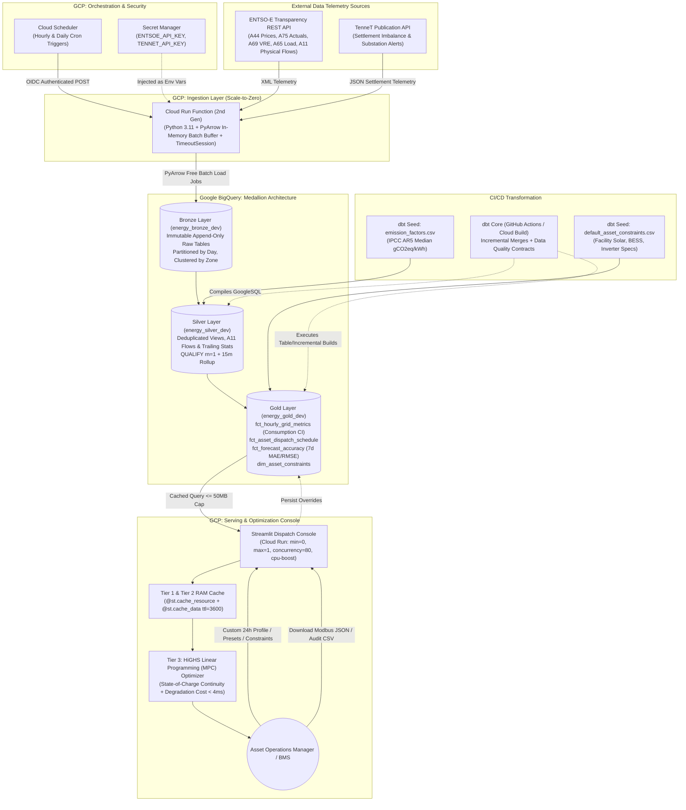

# OptimalEnergy: Autonomous Commercial Asset Energy Arbitrage & Carbon Dispatch Platform

> **A Production Zero-Cost Serverless Data Pipeline, Real-Time Model Predictive Control (MPC) Battery Storage Optimizer, and Flow-Traced Scope 2 Carbon Accounting Engine on Google Cloud Platform**

[](https://github.com/your-username/energy-carbon-pipeline/actions/workflows/ci.yml)
[](https://github.com/your-username/energy-carbon-pipeline/actions/workflows/dbt_hourly_run.yml)
[](LICENSE)
[](https://github.com/astral-sh/ruff)

---

## Table of Contents

1. [Executive Summary & Commercial Motivation](#1-executive-summary--commercial-motivation)
2. [End-to-End System Architecture](#2-end-to-end-system-architecture)
3. [Zero-Cost Serverless FinOps & Quota Mathematics](#3-zero-cost-serverless-finops--quota-mathematics)
4. [External API Integrations & Telemetry Engineering](#4-external-api-integrations--telemetry-engineering)
5. [The Medallion Warehouse Architecture (BigQuery + dbt)](#5-the-medallion-warehouse-architecture-bigquery--dbt)
6. [Mathematical Formulations & Derivations](#6-mathematical-formulations--derivations)
7. [Commercial Asset Dispatch Console & UX (Streamlit)](#7-commercial-asset-dispatch-console--ux-streamlit)
8. [Repository Structure & File-by-File Blueprint](#8-repository-structure--file-by-file-blueprint)
9. [Infrastructure-as-Code (Terraform Provisioning)](#9-infrastructure-as-code-terraform-provisioning)
10. [Data Transformation & Testing Layer (dbt Core)](#10-data-transformation--testing-layer-dbt-core)
11. [CI/CD, Code Quality & Local Testing](#11-cicd-code-quality--local-testing)
12. [Local Quickstart & Execution Guide](#12-local-quickstart--execution-guide)
13. [Production Cloud Deployment Guide](#13-production-cloud-deployment-guide)

---

## 1. Executive Summary & Commercial Motivation

Wholesale electricity in Europe clears on a **marginal pricing auction** (the *Merit Order Effect*). Generators bid capacity ordered by short-run marginal costs: variable renewables (solar and wind at $\approx 0\text{ EUR/MWh}$) clear first, followed by nuclear, hydro, coal, and natural gas peaking plants (up to $160+\text{ EUR/MWh}$). The last generator needed to meet demand sets the clearing price ($P_t$) for all participants.

Because financial markets and physical grid telemetry operate independently, **energy price and carbon intensity frequently decouple**:

* **The Nighttime Baseload Trap (02:00–05:00):** Demand drops, shutting off peaker gas plants and driving prices down. However, with zero solar generation, the residual load is often met by coal or lignite, causing **Carbon Intensity ($CI_t$) to spike** even when electricity is cheap.
* **The Midday Solar Duck Curve (12:00–15:00):** Massive solar and wind generation pushes fossil plants out of the merit order, creating **negative prices ($P_t < 0$)** and minimal carbon intensity simultaneously.
* **The Cross-Border Flow Dilemma (Consumption vs. Production Carbon):** Calculating carbon intensity based purely on domestic generators inside a bidding zone misrepresents the electricity sitting on the wires. If the Netherlands imports nuclear power from France or hydro from Norway (NorNed cable), domestic production accounting overstates emissions. OptiGrid implements flow-tracing to calculate true **Scope 2 Consumption Carbon Intensity**.
* **Substation Congestion Bottlenecks:** Local transmission grid operators (such as TenneT in the Netherlands or PSE in Poland) issue physical grid export restrictions. Commercial solar arrays without automated storage or curtailment controls risk heavy financial penalties or substation overload.

**OptiGrid** bridges wholesale electricity markets, physical power grid telemetry, and transmission operator grid constraints. It provides automated day-ahead battery energy storage system (BESS) scheduling via **High-Speed Linear Programming (HiGHS MPC)**, industrial load ramping, cell degradation safeguards, and solar export curtailment controls across three major European bidding zones:
* 🇳🇱 **Netherlands (`10YNL----------L`)**
* 🇩🇪🇱🇺 **Germany-Luxembourg (`10Y1001A1001A82H`)**
* 🇵🇱 **Poland (`10YPL-AREA-----S`)**

---

## 2. End-to-End System Architecture

The pipeline eliminates idle cloud infrastructure by utilizing an **event-driven, scale-to-zero serverless architecture** across Google Cloud Platform (GCP).



---

## 3. Zero-Cost Serverless FinOps & Quota Mathematics

Traditional enterprise data engineering architectures provision managed clusters (e.g., Cloud Composer / Apache Airflow) that bill continuously 24/7, costing **~$300–$500/month** even when idling 99.9% of the day.

OptiGrid scales entirely to zero between executions. Ingestion containers spin up for ~3.5 seconds per run, stream data via shared batch pools, and terminate immediately.

### Resource-by-Resource Monthly Quota Breakdown (31 Days)

| Service | Pipeline Monthly Consumption Calculation | Monthly Usage | GCP Always-Free Tier Limit | % of Quota Used |
| :--- | :--- | :--- | :--- | :--- |
| **Cloud Run Compute (vCPU)** | Ingestion: $744\text{ runs} \times 3.5\text{s} \times 1\text{ vCPU} = 2,604\text{s}$<br/>Dashboard: $100\text{ visits} \times 5\text{s} \times 1\text{ vCPU} = 500\text{s}$ | **$3,104\text{ vCPU-s}$** | $180,000\text{ vCPU-s / mo}$ | **$1.72\%$** |
| **Cloud Run Memory (RAM)** | Ingestion: $2,604\text{s} \times 0.5\text{ GiB} = 1,302\text{ GiB-s}$<br/>Dashboard: $500\text{s} \times 0.5\text{ GiB} = 250\text{ GiB-s}$ | **$1,552\text{ GiB-s}$** | $360,000\text{ GiB-s / mo}$ | **$0.43\%$** |
| **Cloud Run Invocations** | $744\text{ cron runs} + 2,000\text{ UI requests}$ | **$\sim 2,750\text{ reqs}$** | $2,000,000\text{ reqs / mo}$ | **$0.14\%$** |
| **BigQuery Storage** | $\sim 6,500\text{ rows/month} \times 120\text{ bytes} \approx 0.8\text{ MB/mo}$ | **$< 0.01\text{ GiB}$** | $10.0\text{ GiB active / mo}$ | **$< 0.1\%$** |
| **BigQuery Query Compute** | dbt Builds ($744 \times 2\text{ MB}$) + Dashboard ($744 \times 1\text{ MB}$) | **$\sim 2.22\text{ GiB}$** | $1,024\text{ GiB (1 TiB) / mo}$ | **$0.22\%$** |
| **Artifact Registry** | Container images with Terraform `keep_count = 1` | **$0.28\text{ GiB}$** | $0.50\text{ GiB / mo}$ | **$56.0\%$** |
| **Secret Manager** | 2 active secrets (`ENTSOE_API_KEY`, `TENNET_API_KEY`) | **$2\text{ versions}$** | $6\text{ versions / mo}$ | **$33.3\%$** |
| **Cloud Scheduler** | 4 cron triggers (Hourly Actuals, Daily Forecasts, TenneT, Cross-Border) | **$4\text{ jobs}$** | $3\text{ free jobs + \$0.10/mo}$ | **$\sim \$0.10 / \text{mo}$** |
| **Monthly Bill** | | | | **~$0.00 / month** |

### The Streaming API vs. PyArrow Batch Load Trap
`bigquery_client.insert_rows_json()` uses BigQuery's legacy Streaming API, which bypasses free query quotas, bills $0.01 per 200 MB ingested, and locks partitions against DML merges for up to 90 minutes. OptiGrid utilizes `client.load_table_from_dataframe()` with PyArrow Parquet serialization, executing on Google's shared batch slot pool at **$0.00 compute cost**.

---

## 4. External API Integrations & Telemetry Engineering

### A. ENTSO-E Transparency Platform REST API
* **Base URL:** `https://web-api.tp.entsoe.eu/api`
* **Authentication:** Query parameter security token (`?securityToken=...`)
* **Area Identifiers (EIC Codes):**
  * Netherlands: `10YNL----------L`
  * Germany-Luxembourg: `10Y1001A1001A82H`
  * Poland: `10YPL-AREA-----S`
* **HTTP Socket Resilience:** Configured with `TimeoutSession(timeout=20)` and `retry_count=2` to eliminate TCP socket freezes on slow Transparency endpoints.

#### Core Endpoints & Document Types

| Dataset | documentType | processType | Parameter Name | Resolution | Telemetry Role |
| :--- | :--- | :--- | :--- | :--- | :--- |
| **Day-Ahead Prices** | `A44` | *None* | `in_Domain` = `out_Domain` | `PT60M` / `PT15M` | Published daily at 12:45 CET for all 24 hours of $D+1$ in $\text{EUR/MWh}$. |
| **Actual Generation** | `A75` | `A16` (Realised) | `in_Domain` | `PT15M` / `PT60M` | Near real-time generation by fuel type up to $t_{\text{now}}$ in $\text{MW}$. |
| **Cross-Border Physical Flows** | `A11` | *None* | `in_Domain` / `out_Domain` | `PT60M` / `PT15M` | Interconnector import/export flows between bidding zones in $\text{MW}$. |
| **Wind & Solar Forecast**| `A69` | `A01` (Day Ahead) | `in_Domain` | `PT15M` / `PT60M` | Day-ahead solar, onshore wind, and offshore wind power forecast in $\text{MW}$. |
| **Total Load Forecast** | `A65` | `A01` (Day Ahead) | `outBiddingZone_Domain` | `PT15M` / `PT60M` | Expected total electrical grid demand across $D+1$ in $\text{MW}$. |

### B. TenneT Publication REST API (Dutch Transmission Grid)
* **Base URL:** `https://api.tennet.eu/publications/v1`
* **Authentication:** Custom HTTP header (`apikey: ...`)
* **Settlement Prices (`/settlement-prices`):** Returns 15-minute imbalance settlement telemetry ($ISP$) including shortage price, surplus price, regulation state (-1, 0, +1), and upward/downward dispatch volumes. Accounts for the TSO settlement delay window by querying a sliding 24-to-48 hour lookback.
* **Congestion Alerts:** Telemetry covering Dutch grid substations (e.g., `NL-RANDSTAD-NORTH`, `NL-RANDSTAD-SOUTH`). When active congestion restrictions occur, export capacity limits are de-rated to protect substation feeder transformers.

---

## 5. The Medallion Warehouse Architecture (BigQuery + dbt)

```text
energy-carbon/
├── Bronze Layer (Raw Ingestion Landing - Append-Only Batch Loads)
│   ├── raw_generation_actuals      [Partition: DATE(timestamp_utc) | Cluster: bidding_zone, psr_type]
│   ├── raw_day_ahead_prices        [Partition: DATE(timestamp_utc) | Cluster: bidding_zone]
│   ├── raw_grid_forecasts          [Partition: DATE(timestamp_utc) | Cluster: bidding_zone, metric_type]
│   ├── raw_crossborder_flows       [Partition: DATE(timestamp_utc) | Cluster: bidding_zone]
│   ├── raw_tennet_imbalance        [Partition: DATE(timestamp_utc) | Cluster: bidding_zone]
│   └── raw_tennet_congestion       [Partition: DATE(timestamp_utc) | Cluster: bidding_zone]
│
├── Silver Layer (Deduplication, Grain Alignment & Trailing Stats)
│   ├── stg_generation_actuals      (View: Native 15m dedup -> Hourly downsampling via AVG)
│   ├── stg_day_ahead_prices        (View: Hourly price grain alignment)
│   ├── stg_grid_forecasts          (View: Hourly solar, wind, load pivot)
│   ├── stg_crossborder_flows       (View: ENTSO-E A11 hourly interconnector physical power flows)
│   ├── stg_tennet_imbalance        (View: Hourly average shortage/surplus settlement prices)
│   ├── stg_tennet_congestion       (View: Hourly substation congestion severity & export factors)
│   ├── int_grid_trailing_baselines (Table: Trailing 72h baseload stats + 168h thermal fleet factor)
│   └── int_forecast_carbon_hourly  (Incremental: Future residual thermal carbon model)
│
└── Gold Layer (Serving Marts & Optimization Ledger)
    ├── dim_asset_constraints       (Incremental: Commercial facility physical parameters with UI sync)
    ├── fct_hourly_grid_metrics     (Incremental: Flow-traced Consumption CI, prices, & bounds)
    ├── fct_forecast_accuracy       (Incremental: Self-auditing rolling 7d MAE & RMSE MLOps mart)
    └── fct_asset_dispatch_schedule (Table: Stateful BESS dispatch ledger with recursion parity)
```

---

## 6. Mathematical Formulations & Derivations

### Step 1: Consumption vs. Production Carbon Intensity (Flow-Tracing)
Pure Production Carbon reflects only power plants physically situated inside a bidding zone:

$$CI^{\text{prod}}_t = \frac{\sum_{i \in \text{Fuels}} \left( G_{i,t} \times EF_i \right)}{\sum_{i \in \text{Fuels}} G_{i,t}} \quad \left[\frac{\text{gCO}_2\text{eq}}{\text{kWh}}\right]$$

To meet **GHG Protocol Scope 2 Location-Based Accounting**, OptiGrid traces physical cross-border imports ($F_{j \to z, t}$) from connected transmission neighbors ($j \in \text{Neighbors}$) to determine the actual carbon intensity of the energy consumed on the local wire:

$$CI^{\text{cons}}_t = \frac{\sum_{i} G_{i,t} EF_i + \sum_{j} \max\left(0, F_{j \to z, t}\right) \times CI^{\text{prod}}_{j,t}}{\sum_{i} G_{i,t} + \sum_{j} \max\left(0, F_{j \to z, t}\right)}$$

### Step 2: Self-Calibrating Day-Ahead Carbon Intensity Forecast ($\widehat{CI}_t$)
For future hours ($t > t_{\text{now}}$), residual thermal demand is estimated dynamically:

$$\hat{R}_t = \max\left(0, \; \hat{L}_t - \hat{G}_{\text{VRE}, t} - \hat{G}_{\text{base}}\right)$$

Where:
* $\hat{L}_t$ is forecasted total load (`A65`).
* $\hat{G}_{\text{VRE}, t} = \hat{G}_{\text{solar}, t} + \hat{G}_{\text{wind\_on}, t} + \hat{G}_{\text{wind\_off}, t}$ (`A69`).
* $\hat{G}_{\text{base}}$ and $EF_{\text{base}}$ calibrate dynamically from trailing 72 hours of low-carbon baseload (`B09`, `B11`, `B14`).
* $\overline{EF}_{\text{thermal}}$ is the empirical emission factor of dispatchable thermal plants over the trailing 168 hours (7 days):

$$\overline{EF}_{\text{thermal}} = \frac{\sum_{\tau \in [t_{\text{now}}-168\text{h}, \, t_{\text{now}}]} \sum_{i \in \text{Thermal}} G_{i,\tau} EF_i}{\sum_{\tau \in [t_{\text{now}}-168\text{h}, \, t_{\text{now}}]} \sum_{i \in \text{Thermal}} G_{i,\tau}}$$

The physical residual-load forecast equation is:

$$\widehat{CI}_t = \frac{\hat{G}_{\text{solar}, t} EF_{\text{solar}} + \hat{G}_{\text{wind\_on}, t} EF_{\text{wind\_on}} + \hat{G}_{\text{wind\_off}, t} EF_{\text{wind\_off}} + \hat{G}_{\text{base}} EF_{\text{base}} + \hat{R}_t \overline{EF}_{\text{thermal}}}{\max\left(\hat{L}_t, \; \hat{G}_{\text{VRE}, t} + \hat{G}_{\text{base}}\right)}$$

### Step 3: High-Speed Linear Programming (HiGHS MPC) Battery Arbitrage
OptiGrid formulates the multi-period day-ahead BESS dispatch as a **Linear Program (LP)** solved via the high-speed C++ HiGHS solver in `scipy.optimize.linprog`:

$$\min_{c_t, d_t} \sum_{t=1}^N \left( \left(P_t + \lambda^{\text{deg}}\right) c_t - \left(P_t - \lambda^{\text{deg}}\right) d_t - \beta_t^{\text{cong}} c_t \right)$$

Subject to physical constraints for all $t \in \{1, \dots, N\}$:
1. **Power Limits:** $0 \le c_t \le P^{\text{max\_charge}}, \quad 0 \le d_t \le P^{\text{max\_discharge}}$
2. **State-of-Charge Continuity:**
   $$SoC_t = SoC_0 + \sum_{\tau=1}^t \left( c_\tau \sqrt{\eta} - \frac{d_\tau}{\sqrt{\eta}} \right)$$
3. **Capacity Bounds:** $SoC^{\text{min}} \le SoC_t \le SoC^{\text{max}}$
4. **Battery Cell Degradation Gate ($\lambda^{\text{deg}}$):** Marginal degradation cost amortized per kWh cycled ($\sim 0.02\text{--}0.04\text{ EUR/kWh}$). The battery only cycles when the price spread or carbon value exceeds physical cell wear.
5. **Congestion & Negative Price Absorption ($\beta_t^{\text{cong}}$):** When rooftop solar generation exceeds substation export caps, the objective prioritizes battery absorption over curtailment.

For a 36-hour horizon, the LP solves to global mathematical optimality in **$\sim 3.8\text{ ms}$**, maintaining sub-10ms UI reactivity in Streamlit.

### Step 4: Discrete Sliding Window Convolution ($K$-Hour Cycle)
For continuous flexible industrial loads running across $K$ consecutive hours:

$$t^* = \underset{t}{\arg\min} \left( \frac{1}{K} \sum_{k=0}^{K-1} \text{Score}_{t+k}(\alpha) \right)$$

Evaluated in container RAM via 1D array convolution (`np.convolve(scores, np.ones(K)/K, mode='valid')`) in $< 2\text{ ms}$.

### Step 5: Self-Auditing Forecast Backtesting Mart (MAE & RMSE)
The Gold model `fct_forecast_accuracy` tracks prediction accuracy by joining $D-1$ day-ahead forecasts against today's realized $D$ actuals:

$$\text{MAE}_{\text{7d}} = \frac{1}{168} \sum_{t=1}^{168} \left| \widehat{CI}_t - CI_t \right|, \qquad \text{RMSE}_{\text{7d}} = \sqrt{\frac{1}{168} \sum_{t=1}^{168} \left( \widehat{CI}_t - CI_t \right)^2}$$

---

## 7. Commercial Asset Dispatch Console & UX (Streamlit)

The dashboard provides a commercial-grade operator console with high-contrast executive telemetry:

* **One-Click Facility Archetype Presets:**
  * 🧊 *Cold Storage Logistics Warehouse:* High thermal inertia, 500 kW solar, 1 MWh BESS.
  * ⚡ *EV Fleet Charging Depot:* High peak demand, 800 kW solar, 2.2 MWh BESS.
  * 🏭 *Batch Chemical / Industrial Plant:* High flexible process load, 2.5 MW solar, 4 MWh BESS.
* **Custom 24-Hour Load Curve Input:** Upload facility consumption profiles via CSV/JSON or tweak baseline demand interactively hour-by-hour via `st.data_editor`.
* **Carbon Shadow Pricing vs. Pareto Weight:** Toggle between intuitive EU ETS Internal Carbon Tax (€/tCO₂, benchmarked to €65/t) and multi-objective Pareto Weight ($\alpha \in [0, 1]$).
* **Executive KPI Delta Cards (Managed MPC vs. Naive Baseline):**
  * *Net Energy Spend:* Total cost and percentage savings.
  * *Net Carbon Footprint:* Total emissions and abated Scope 2 kgCO₂.
  * *Solar Curtailment Avoided:* Rescued kWh via automated BESS pre-charging before substation congestion.
  * *Implied Carbon Abatement Cost:* Calculated in €/tCO₂ avoided.
* **Cost vs. Carbon Pareto Frontier Curve:** 11-point interactive sweep proving the financial trade-off of going greener, with the facility's active operating point highlighted as a glowing diamond.
* **Machine-Actionable BMS Exports:**
  * 🔌 **Modbus Register JSON Payload:** Timestamped `CHARGE_KW`, `DISCHARGE_KW`, `EXPORT_LIMIT_KW`, and `FLEX_LOAD_SETPOINT_KW` ready for edge PLCs or Home Assistant / Node-RED.
  * 📊 **CSV Audit Ledger:** Comprehensive financial and Scope 2 ESG audit records.

---

## 8. Repository Structure & File-by-File Blueprint

```text
energy-carbon/
├── .github/
│   └── workflows/
│       ├── ci.yml                 # Runs Ruff (lint + format), Pytest, and SQLFluff on PR
│       ├── dbt_hourly_run.yml     # Hourly cron executing dbt incremental transformations
│       ├── deploy_cloud_run.yml   # Builds Docker image and deploys Streamlit to Cloud Run
│       ├── terraform_plan.yml     # Validates Terraform HCL infrastructure diff on PR
│       └── terraform_apply.yml    # Applies Terraform changes on merge to main
├── terraform/
│   ├── main.tf                    # GCP Infrastructure: BigQuery, Cloud Run, Cloud Functions, IAM
│   ├── variables.tf               # Input variables (project_id, region, alert_email)
│   ├── outputs.tf                 # Output endpoints (Function URI, Cloud Run Dashboard URL)
│   └── terraform.tfvars.example   # Example configuration variables
├── ingestion/
│   ├── main.py                    # Cloud Function HTTP entry point supporting multi-zone ingestion
│   ├── entsoe_client.py           # ENTSO-E client with TimeoutSession, A11 flows & PSR normalization
│   ├── tennet_client.py           # TenneT settlement prices client with lag recovery
│   ├── bq_loader.py               # Free PyArrow in-memory batch loader to BigQuery
│   └── requirements.txt           # Ingestion dependencies (entsoe-py, pyarrow, google-cloud-bigquery)
├── dbt_energy/
│   ├── dbt_project.yml            # dbt configuration with incremental BigQuery merge strategies
│   ├── profiles.yml               # BigQuery adapter connection profile
│   ├── seeds/
│   │   ├── emission_factors.csv          # IPCC AR5 emission factors lookup table
│   │   └── default_asset_constraints.csv # Commercial facility baseline profiles (NL, DE, PL)
│   └── models/
│       ├── bronze/sources.yml     # BigQuery source table definitions
│       ├── silver/
│       │   ├── stg_generation_actuals.sql  # Deduplication & hourly fuel energy rollup
│       │   ├── stg_day_ahead_prices.sql    # Deduplication & hourly wholesale prices
│       │   ├── stg_grid_forecasts.sql      # Solar, wind, & total load forecasts
│       │   ├── stg_crossborder_flows.sql   # ENTSO-E A11 physical interconnector power flows
│       │   ├── stg_tennet_imbalance.sql    # TenneT settlement imbalance telemetry
│       │   ├── stg_tennet_congestion.sql   # Substation congestion limits & redispatch
│       │   └── schema.yml                  # Silver data quality test contracts
│       ├── intermediate/
│       │   ├── int_grid_trailing_baselines.sql # 72h baseload & 168h thermal fleet calibrator
│       │   └── int_forecast_carbon_hourly.sql  # Physical day-ahead residual carbon model
│       └── gold/
│           ├── dim_asset_constraints.sql       # Live facility constraints with UI overrides
│           ├── fct_hourly_grid_metrics.sql     # Flow-traced Consumption CI & rolling bounds
│           ├── fct_forecast_accuracy.sql       # Rolling 7d MAE & RMSE forecast backtesting mart
│           ├── fct_asset_dispatch_schedule.sql # Stateful hourly BESS simulation ledger
│           └── schema.yml                      # Gold contracts (not_null, unique, accepted_values)
├── dashboard/
│   ├── app.py                     # Streamlit frontend with 3 visual tiers & interactive ledger
│   ├── asset_config.py            # Facility presets, profile sidebar & BigQuery constraint sync
│   ├── data_fetcher.py            # Three-tier caching layer + high-fidelity fallback telemetry
│   ├── optimizer.py               # HiGHS LP MPC battery solver, Pareto engine & convolution
│   ├── Dockerfile                 # Slim Python 3.11 container with startup CPU boost
│   └── requirements.txt           # Dashboard dependencies (streamlit, plotly, scipy, numpy)
├── tests/
│   ├── conftest.py                # Pytest fixtures and mock BigQuery schemas
│   ├── ingestion/
│   │   ├── test_entsoe_client.py  # Unit tests for XML parsing, cross-border flows & PSR codes
│   │   ├── test_tennet_client.py  # Unit tests for settlement extraction & HTTP errors
│   │   └── test_bq_loader.py      # Unit tests for batch load schema enforcement
│   └── dashboard/
│       ├── test_optimizer.py      # Unit tests for HiGHS LP, degradation costs & Pareto curve
│       ├── test_asset_config.py   # Unit tests for facility presets & constraint dataframes
│       └── test_data_fetcher.py   # Unit tests for BigQuery query parameters & accuracy marts
├── run_local.py                   # Local orchestration harness for end-to-end ingestion
├── pyproject.toml                 # Ruff linter and formatter configuration
├── pytest.ini                     # Pytest test discovery rules
└── README.md                      # Comprehensive project documentation
```

---

## 9. Infrastructure-as-Code (Terraform Provisioning)

The [`terraform/main.tf`](file:///Users/mikolajduchlinski/Desktop/energy_carbon/terraform/main.tf) configuration automates the cloud footprint using principle-of-least-privilege IAM service accounts:

1. **BigQuery Datasets:** Creates `energy_bronze_dev`, `energy_silver_dev`, and `energy_gold_dev` in location `EU`.
2. **Service Accounts:**
   * `energy-ingest-sa`: Granted `roles/bigquery.dataEditor` on Bronze and `roles/bigquery.jobUser`.
   * `energy-scheduler-sa`: Granted `roles/run.invoker` to trigger Cloud Functions via OIDC JWT.
   * `energy-streamlit-ui-sa`: Granted `roles/bigquery.dataViewer` on Gold/Silver and `roles/bigquery.dataEditor` on Gold for asset constraint updates.
3. **Secret Manager:** Provisions `entsoe-api-key` and `tennet-api-key`, mounted as environment variables inside Cloud Run.
4. **Cloud Run Function (2nd Gen):** Packages `ingestion/` as an OIDC-authenticated HTTP function with 512Mi RAM and 120s timeout.
5. **Cloud Scheduler Triggers:**
   * Hourly Generation & Flows: `5 * * * *` (CET)
   * Daily Day-Ahead Forecasts: `0 14 * * *` (CET)
   * TenneT Settlement Telemetry: `15 * * * *` (CET)
6. **Artifact Registry:** Configured with `keep_count = 1` auto-cleanup to guarantee zero container storage creep.
7. **Cloud Run Dashboard:** Provisions the Streamlit container with `--min-instances=0 --max-instances=1 --concurrency=80 --cpu-boost`.

---

## 10. Data Transformation & Testing Layer (dbt Core)

Transformations execute inside BigQuery via **dbt Core**:

```bash
cd dbt_energy
dbt seed    # Loads emission_factors.csv and default_asset_constraints.csv
dbt build   # Compiles views, tables, incremental models, and executes 29 automated tests
cd ..
```

---

## 11. CI/CD, Code Quality & Local Testing

The repository enforces formatting and regression tests across the pipeline:

```bash
# 1. Lint and format Python codebase
ruff check .
ruff format --check .

# 2. Run full Python test suite (35 automated tests)
pytest tests/ -v
```

The GitHub Actions workflow [`.github/workflows/ci.yml`](file:///Users/mikolajduchlinski/Desktop/energy_carbon/.github/workflows/ci.yml) executes these checks on every Pull Request.

---

## 12. Local Quickstart & Execution Guide

### Prerequisites
* Python 3.10, 3.11, or 3.12
* Google Cloud SDK (`gcloud`) authenticated to your GCP project
* Free API keys from [ENTSO-E](https://transparency.entsoe.eu/) and [TenneT](https://www.tennet.eu/)

### Step 1: Environment Setup
```bash
git clone https://github.com/your-username/energy-carbon-pipeline.git
cd energy-carbon-pipeline

python3 -m venv .venv
source .venv/bin/activate
pip install -r dashboard/requirements.txt
pip install -r ingestion/requirements.txt
pip install ruff pytest dbt-bigquery

cp .env.example .env
# Edit .env with your GCP_PROJECT_ID, ENTSOE_API_KEY, and TENNET_API_KEY
```

### Step 2: Infrastructure Provisioning (Terraform)
```bash
cd terraform
terraform init
terraform plan
terraform apply -auto-approve
cd ..
```

### Step 3: Run Ingestion (Load BigQuery Bronze)
```bash
python run_local.py
```
*Executes all 4 steps: actual generation, cross-border flows, day-ahead prices & forecasts, and TenneT settlement data.*

### Step 4: Run Warehouse Transformations (dbt Build)
```bash
cd dbt_energy
dbt deps
dbt seed
dbt build
cd ..
```
*Expected output: All 43 models, seeds, and tests pass.*

### Step 5: Launch the Streamlit Dashboard
```bash
streamlit run dashboard/app.py
```
Open `http://localhost:8501` to test facility archetypes, custom 24h curve adjustments, HiGHS LP dispatch, the Pareto frontier, and Modbus/CSV exports.

---

## 13. Production Cloud Deployment Guide

To deploy the latest containerized dashboard and ingestion functions to Google Cloud:

### Deploying the Streamlit Dashboard to Cloud Run
```bash
# 1. Authenticate Docker with Google Artifact Registry
gcloud auth configure-docker europe-west4-docker.pkg.dev

# 2. Build and submit container via Cloud Build
gcloud builds submit dashboard/ \
    --tag="europe-west4-docker.pkg.dev/${GCP_PROJECT_ID}/energy-pipeline-containers/dashboard:latest"

# 3. Deploy to Cloud Run with scale-to-zero and startup CPU boost
gcloud run deploy energy-optimizer-dashboard \
    --image="europe-west4-docker.pkg.dev/${GCP_PROJECT_ID}/energy-pipeline-containers/dashboard:latest" \
    --region="europe-west4" \
    --service-account="energy-streamlit-ui-sa@${GCP_PROJECT_ID}.iam.gserviceaccount.com" \
    --min-instances=0 \
    --max-instances=1 \
    --concurrency=80 \
    --cpu=1 \
    --memory=512Mi \
    --cpu-boost \
    --set-env-vars="GCP_PROJECT_ID=${GCP_PROJECT_ID},BQ_DATASET_GOLD=energy_gold_dev,BQ_DATASET_SILVER=energy_silver_dev" \
    --allow-unauthenticated
```

### Updating Ingestion Cloud Function via Terraform
```bash
cd terraform
terraform apply -target=google_cloudfunctions2_function.ingestor -auto-approve
cd ..
```

---

## License

This project is licensed under the MIT License - see the [LICENSE](LICENSE) file for details.
